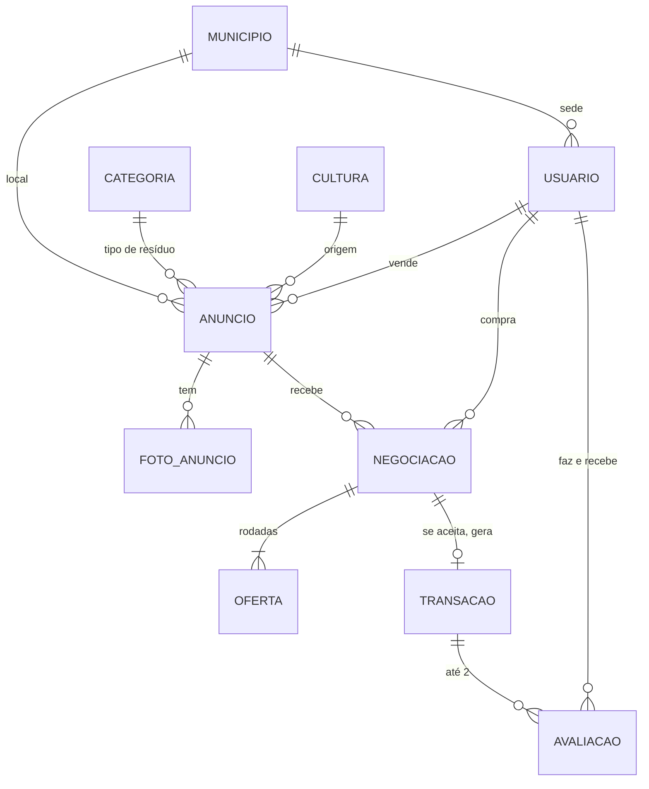

# Banco de Resíduos

Marketplace que conecta quem tem resíduos e subprodutos agrícolas (cascas, bagaços, sementes, frutas fora do padrão) a quem pode dar a eles um novo uso. Começa pelo Vale do São Francisco, com foco em Petrolina/PE e Juazeiro/BA.

Projeto da disciplina de Inovação Tecnológica — FACAPE.

## O que o MVP faz

- **Conta única**: todo usuário anuncia e compra. No cadastro informa o tipo de organização (produtor, agroindústria, cooperativa, empresa).
- **Anúncios** com tipo de resíduo, cultura, quantidade, preço por unidade, frequência, condições de retirada, até 5 fotos e ponto no mapa.
- **Busca** por texto, tipo, cultura, município e distância, em lista ou mapa.
- **Negociação na plataforma**: proposta, contraproposta, aceite ou recusa, tudo registrado.
- **Transação com pagamento simulado**: ao aceitar, o estoque é reservado e a comissão de 5% é calculada. O comprador "paga", confirma a retirada e o valor líquido é considerado repassado ao vendedor. Nenhum dinheiro real circula.
- **Avaliações** mútuas depois da retirada, com reputação no perfil público.
- **Painel administrativo**: comissões, volume negociado, usuários, moderação de anúncios e transações.

## Como rodar

Pré-requisito: [Docker](https://docs.docker.com/get-docker/) em execução.

```bash
docker compose up --build
```

Acesse **http://localhost:3000**. Na primeira execução o banco é criado, as migrations são aplicadas e os dados de demonstração são carregados.

| Conta de demonstração | E-mail | Senha |
| --- | --- | --- |
| Vendedor (agroindústria) | `joao@exemplo.com` | `demo1234` |
| Compradora (compostagem) | `fernanda@exemplo.com` | `demo1234` |
| Administração | `admin@bancoderesiduos.com.br` | `admin1234` |

As outras contas de demonstração (`maria@`, `ana@`, `carlos@`, `jose@`, `ricardo@`, `juliana@exemplo.com`) usam a mesma senha `demo1234`.

Para parar: `Ctrl+C`. Para apagar tudo, inclusive os dados: `docker compose down -v`.

Portas e senhas podem ser ajustadas em um arquivo `.env` na raiz (modelo em [.env.example](.env.example)).

> O mapa usa imagens do OpenStreetMap e precisa de internet. Sem conexão, os marcadores aparecem sobre um fundo liso e todo o resto funciona.

### Roteiro sugerido para a demonstração

1. Abra duas janelas (uma anônima). Entre como `fernanda@exemplo.com` em uma e `joao@exemplo.com` na outra.
2. Fernanda já propôs comprar os 500 kg de casca de manga do João a R$ 0,30/kg (o exemplo do pitch).
3. Como João, abra **Negociações**, faça uma contraproposta ou aceite.
4. Como Fernanda, aceite, **pague (simulado)** e **confirme a retirada**.
5. Avalie pelos dois lados e veja a reputação no perfil público.
6. Entre como administração e mostre a comissão de 5% no painel.

## Desenvolvimento

Para programar com recarga automática, rode só o banco no Docker e os dois aplicativos direto na máquina (Node.js 22 ou mais recente):

```bash
npm run instalar            # dependências de apps/api e apps/web
npm run db                  # PostgreSQL em localhost:5434
cp apps/api/.env.example apps/api/.env

cd apps/api
npm run db:deploy           # aplica as migrations
npm run db:seed             # catálogo + dados de demonstração
npm run dev                 # API em http://localhost:3333

# em outro terminal
cd apps/web
npm run dev                 # site em http://localhost:3000
```

| Comando (na raiz) | O que faz |
| --- | --- |
| `npm test` | Testes da API (integração, com banco) e do frontend |
| `npm run verificar` | Tipos, lint e testes de tudo |
| `npm run studio` | Prisma Studio, para ver e editar o banco no navegador |

Os testes da API usam um banco separado, `banco_residuos_test`, criado automaticamente no PostgreSQL do `npm run db`. Para usar outro servidor, defina `TEST_DATABASE_URL` (o nome do banco precisa conter `test`; ele é apagado a cada execução).

### Mudando o banco de dados

```bash
cd apps/api
# 1. edite prisma/schema.prisma
npx prisma migrate dev --name descricao_da_mudanca   # cria e aplica a migration
npm run db:generate                                   # atualiza o Prisma Client
```

Regras que o Prisma não expressa (CHECKs e o índice único parcial) estão escritas à mão no fim da migration inicial.

### Mudando dependências

O `npm ci` do build Docker exige que o `package-lock.json` esteja em dia com o npm da imagem (`node:24-slim`), que pode ser mais novo que o da sua máquina. Depois de instalar ou atualizar um pacote, regenere o lockfile com essa versão antes de subir o Docker:

```bash
npx -y npm@11.19.1 install --package-lock-only   # dentro de apps/api ou apps/web
```

Se o build falhar com `Missing: ... from lock file`, é isso.

## Arquitetura

```
navegador ──► web (Next.js, :3000) ──► api (Express, :3333) ──► PostgreSQL
                 │  /api/* e /uploads/* são repassados à API
                 └─ todo o resto são páginas React
```

O navegador só conversa com o Next.js. Como tudo sai da mesma origem, o cookie de sessão (`httpOnly`, `SameSite=Lax`) funciona sem CORS.

| Camada | Tecnologia | Pasta |
| --- | --- | --- |
| Frontend | Next.js 16 (App Router), React 19, Tailwind CSS 4, SWR, Leaflet | [apps/web](apps/web) |
| Backend | Node.js, Express 5, Zod, Prisma 7 | [apps/api](apps/api) |
| Banco | PostgreSQL 16 | [apps/api/prisma](apps/api/prisma) |

```
apps/api
├── prisma/
│   ├── schema.prisma        modelo de dados
│   ├── migrations/          SQL versionado
│   └── seed.ts              catálogo e dados de demonstração
├── src/
│   ├── rotas/               auth, usuarios, anuncios, negociacoes, transacoes, admin, publico
│   ├── middleware/          sessão (JWT em cookie) e tratamento de erros
│   └── lib/                 dinheiro (comissão), geo (distância), uploads, validação
└── tests/                   testes de integração (vitest + supertest)

apps/web
├── app/                     uma pasta por rota; page.tsx é a moldura, tela.tsx o conteúdo
├── components/              botões, campos, mapa, cartão de anúncio, formulários
└── lib/                     cliente da API, sessão, formatação, tipos
```

### Modelo de dados



- **Dinheiro em centavos** (inteiros) e **quantidades em `NUMERIC(12,3)`**: nenhum cálculo financeiro usa ponto flutuante.
- A **transação guarda um retrato** de quantidade, preço, taxa, comissão e líquido no momento do aceite; mudar a taxa depois não altera negócios antigos.
- **Restrições no banco**: quantidades e preços não negativos, `total = comissão + líquido`, nota de 1 a 5, comprador diferente do vendedor e uma única negociação aberta por comprador e anúncio (índice único parcial).

### Fluxo do negócio

```
Negociação:  ABERTA ──aceite──► ACEITA
                │
                ├──vendedor recusa──► RECUSADA
                └──comprador desiste─► CANCELADA

Transação:   AGUARDANDO_PAGAMENTO ──pagar──► PAGA ──confirmar retirada──► CONCLUIDA
                │
                └──cancelar (devolve o estoque)──► CANCELADA
```

- As ofertas se alternam: quem fez a última proposta espera a resposta da outra parte.
- O **aceite é atômico**: o estoque só é descontado se o anúncio continua ativo e ainda tem a quantidade. Dois aceites simultâneos não vendem o mesmo lote (há teste para isso).
- A comissão é `total × 5%`, arredondada ao centavo, descontada do vendedor. A taxa vem de `COMISSAO_BPS` (500 = 5%).
- Telefone e e-mail das partes só aparecem depois do negócio fechado.
- Doações (preço zero) pulam a etapa de pagamento.

### API

Todas as rotas ficam sob `/api`. Erros voltam como `{ "erro": "mensagem", "campos": { ... } }`.

| Rota | Descrição |
| --- | --- |
| `POST /auth/cadastro`, `/auth/login`, `/auth/logout`, `GET /auth/eu` | Conta e sessão |
| `GET /catalogo`, `GET /estatisticas` | Listas de apoio e números da página inicial |
| `GET /anuncios` | Busca: `q`, `categoria`, `cultura`, `municipioId`, `lat`+`lng`+`raioKm`, `ordenar`, `pagina` |
| `GET /anuncios/:id`, `GET /anuncios/meus` | Detalhe e anúncios do usuário |
| `POST /anuncios`, `PATCH /anuncios/:id` | Criar e editar (inclui pausar e encerrar) |
| `POST /anuncios/:id/fotos`, `DELETE /anuncios/:id/fotos/:fotoId` | Fotos (multipart, campo `fotos`) |
| `POST /negociacoes`, `GET /negociacoes`, `GET /negociacoes/:id` | Abrir, listar e ver |
| `POST /negociacoes/:id/ofertas`, `/aceitar`, `/encerrar` | Contrapropor, aceitar, recusar ou desistir |
| `GET /transacoes`, `GET /transacoes/:id` | Negócios fechados |
| `POST /transacoes/:id/pagar`, `/confirmar-retirada`, `/cancelar`, `/avaliacoes` | Andamento e avaliação |
| `GET /usuarios/:id`, `PATCH /usuarios/eu`, `GET /usuarios/eu/resumo` | Perfil público, edição e painel |
| `GET /admin/resumo`, `/admin/usuarios`, `/admin/anuncios`, `/admin/transacoes` | Administração |
| `PATCH /admin/usuarios/:id`, `PATCH /admin/anuncios/:id` | Desativar conta, suspender anúncio |

## Segurança

- Senhas com bcrypt; sessão em JWT dentro de cookie `httpOnly` e `SameSite=Lax`.
- Toda entrada é validada com Zod; campos desconhecidos são descartados (não dá para se cadastrar como administrador nem trocar o dono de um anúncio).
- Cada rota confere a posse: só os participantes enxergam uma negociação ou transação.
- Fotos: tipo conferido pelos primeiros bytes do arquivo, nome aleatório em disco, limite de 5 MB e 5 fotos.
- Login bloqueado por 15 minutos depois de 10 senhas erradas para a mesma conta.
- No Docker, o segredo das sessões é gerado na primeira execução e guardado em um volume; não há segredo padrão no repositório.

## Limitações conhecidas

- **Pagamento simulado.** Não há integração com gateway; "pagar" apenas registra o pagamento.
- **Sem notificações** por e-mail ou WhatsApp. As telas se atualizam sozinhas a cada 15 a 30 segundos.
- **Sem recuperação de senha** e sem confirmação de e-mail.
- **Busca por distância em memória**: o banco pré-filtra por um retângulo e a distância exata é calculada na API. Suficiente para o volume regional; para escalar, usar PostGIS.
- **Fotos em disco local** (volume Docker). Em produção, usar armazenamento de objetos.
- **Limite por IP ausente.** A API enxerga o IP do frontend, não o do visitante. Para publicar na internet, coloque um proxy reverso (Caddy ou nginx) na frente, com HTTPS, e defina `COOKIE_SECURE=true`.
- A API roda o TypeScript com `tsx`, sem etapa de compilação. Simples para o MVP; em produção vale compilar.

## Próximos passos

Do pitch: planos para empresas (mais anúncios, filtros avançados, relatórios), anúncios em destaque e, numa etapa futura, a entrada de transportadores para fechar a logística.

## Documentação do projeto

| Documento | Conteúdo |
| --- | --- |
| [docs/metricas.md](docs/metricas.md) | Plano de métricas acionáveis |
| [docs/testes-usabilidade.md](docs/testes-usabilidade.md) | Roteiro e registro dos testes de usabilidade |
| [docs/roadmap.md](docs/roadmap.md) | Roadmap de escalabilidade e desafios regulatórios (LGPD) |
| [docs/storyboard-demo-day.md](docs/storyboard-demo-day.md) | Roteiro da apresentação e da demo ao vivo |
| [docs/dre.md](docs/dre.md) | DRE simplificado, precificação e ponto de equilíbrio |
| [docs/anterioridade.md](docs/anterioridade.md) | Busca de anterioridade e diferencial |
| [docs/edital-fomento.md](docs/edital-fomento.md) | Edital de fomento simulado (Sertão Inovador) |
| [docs/ecossistema.md](docs/ecossistema.md) | Mapa de parceiros e integrações |
| [docs/dossie-executivo.md](docs/dossie-executivo.md) | Rascunho do Dossiê Executivo |
| [docs/backlog.md](docs/backlog.md) | Backlog e sprints (base do quadro do projeto) |
| [landing/](landing/) | Landing page de captação de leads e como publicá-la |

## Equipe

| Módulo | Responsáveis |
| --- | --- |
| Banco de dados e infraestrutura | Gustavo Moreira, Kelvin Oliveira, Luana |
| Backend | Matheus Henrique da Fonseca, Luis Felipe |
| Frontend | João Pedro Carvalho, Kathleen Beatriz Loiola |

Docente: Luirys Silva.
